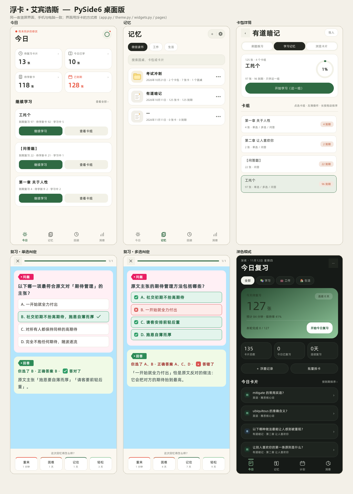

# FrogLog · 蛙记 — PySide6 桌面应用

界面沿用「浮卡」的做法：`app.py` 只管导航装配，页面各自成模块，`theme.py` 出设计令牌 + QSS，
`widgets.py` 放可复用控件，数据落一个 JSON。

界面是**一套竖屏布局**，窗口锁定 380–560 px 宽 —— 电脑上打开是手机比例，同一个界面搬到手机上也是这个排版。



## 运行

```bash
cd ebbinghaus/app
python main.py
```

或双击 `启动 FrogLog · 蛙记.bat`（用 pythonw，无控制台）。

依赖：Python 3.10+、PySide6（本机 6.11.1）。

## 结算页

- 居中卡片：小结缎带、总张数、记住率圆环、记得/需加强/用时三格、FSRS 说明
- 底部：[返回] [下一组]（按卡组列表从上到下取下一组；学习记忆看「到期」，刷题练习看「练习卡」；已经是最后一组时点它会返回并提示「没有下一组了」）


### 七牛云 Kodo（S3 兼容）

| 配置项 | 填什么 |
|---|---|
| Endpoint | https://s3.<区域>.qiniucs.com，如 https://s3.cn-east-1.qiniucs.com |
| Region | 与 Endpoint 一致（留空会自动识别），如 cn-east-1 |
| Bucket | **S3 空间名**（空间概览 → S3 域名里的第一段，可能和空间名不同） |
| 对象 Key | locard/state.json |
| Access / Secret | 七牛「个人中心 → 密钥管理」的 AK / SK |
| Path style | 保持开启 |

常用 Endpoint：华东-浙江 cn-east-1、华东-浙江2 cn-east-2、华北-河北 cn-north-1、华南-广东 cn-south-1、北美-洛杉矶 us-north-1、亚太-新加坡 p-southeast-1、亚太-河内 p-southeast-2、亚太-胡志明 p-southeast-3。

也可以直接把空间概览里的 **S3 域名**（如 80e4gu.s3.cn-east-1.qiniucs.com）粘进 Endpoint，程序会自动拆出 Bucket 和 Region。


## Anki 功能对齐

已补齐（对照 nki-26.08.1/rslib）：

| 功能 | 说明 | 对应 Anki |
|---|---|---|
| 卡组选项 | 学习步骤 / 重学步骤 / 毕业间隔 / 简单间隔 / 目标保持率 / 每日新卡·复习上限 / 最大间隔；可全局或按卡包设置 | deckconfig |
| 每日限额 | 组队列时按「今日新学 / 今日复习」计算剩余额度 | 队列限额 |
| 撤销 | 评分后可撤销（⌘/Ctrl+Z 或菜单），恢复卡片字段与复习记录 | undo |
| 快捷键 | 空格/回车 显示答案·提交，1–4 评分，U 撤销，E 编辑 | reviewer |
| 暂停卡片 | suspended，移出队列 | bury_and_suspend |
| 搁置到明天 | buried_until，次日前不出现 | bury |
| 标签 | 编辑页填写，	ag: 搜索 | tags |
| 搜索语法 | 	ag:x is:new/due/suspended/learning/practice deck:名称 | search |
| 队列统计 | 顶栏 新/学/复 计数 | queue |

尚未实现（Anki 有、本应用没有）：

- 笔记类型与模板（正反向卡、填空 cloze、type-in 输入答案）
- 媒体（图片/音频）与相应编辑器
- 筛选卡组 / 自定义学习（custom study）
- .apkg / .colpkg 导入导出、媒体同步
- 图表统计（复习历史、到期预测）与模拟器
- 查找替换、批量改标签等浏览器高级操作


## 统计图表

设置入口：细数右上角的 **⋯**；统计详情：细数首卡右上角「详情 ›」。

细数首张卡片是「六维健康指数」雷达，右上角「详情 ›」进入完整统计页：

- 关键指标：总卡片 / 已掌握 / 平均间隔 / 留存率
- 复习量：近 30 天每日新学与复习（堆叠柱）
- 到期预测：未来 30 天每天到期数
- 间隔分布：1-3 / 4-7 / 8-14 / 15-30 / 31-90 / 90+
- 卡片状态：新卡 / 学习中 / 复习中 / 暂停 / 搁置（100% 堆叠条）

参照 Anki stats/graphs（reviews / future_due / intervals / card_counts / retention）。

## 窗口与弹窗

- 主窗口启动时居中于屏幕可用区域
- 自绘弹窗（移动到…、知识域管理、同步冲突）居中于主窗口，show 后会再校正一次边框
- 系统弹窗（QMessageBox / QInputDialog / QFileDialog）带 parent，由 Qt 居中于父窗口

## 主题（7 套「池塘纸感」平涂配色）

设置 → 外观 → 主题，两列主题卡（每张是迷你色带 + 纸底 + dock 预览），点一下立刻换色。7 套色相沿用原 Anki 模板，但改成纯色平涂：

| id | 名称 | 深色（色带 / dock / 系统栏） | 浅纸色（页面） |
|---|---|---|---|
| anki-aurora | 极光（默认） | #B23A5B | #F8E9E6 |
| anki-ice | 冰川 | #2E5E8C | #EAF1F7 |
| anki-mint | 薄荷 | #2F7A4F | #EAF4EC |
| anki-champ | 香槟 | #A9761C | #F8F0E1 |
| anki-lilac | 丁香 | #6B4EA8 | #F1ECF8 |
| anki-coral | 珊瑚 | #C4562E | #F9ECE4 |
| anki-lagoon | 潟湖 | #0F7C86 | #E8F4F5 |

页面全部纯色、无渐变；卡片 1.5px 墨线 + 硬投影；顶部色带（紧凑，约 80–100px）主题深色 + 小波浪，底部 dock 主题深色；状态栏 / 手势条透出页面浅纸色，深色系统图标。复习卡区仍按「卡片模板」的 7 套皮肤（天蓝薰衣等），7 套卡片模板保持不变。选择存在 settings.theme；旧版本的 paper / mist / cream / ink / celadon / sunset / night / dusk 会回落到 anki-aurora（极光）。

## 调度算法：FSRS-6（Anki 26 默认）


fsrs.py 按 fsrs-rs 6.6.1 实现，参数与公式都取自该版本源码：

- **权重**：DEFAULT_PARAMETERS（21 个，w[20]=0.1542 为衰减）
- **遗忘曲线**：R = (1 + t/S * factor)^(-w20)，
actor = 0.9^(-1/w20) - 1
- **初始**：S0 = w[rating-1]，D0 = w4 - exp(w5*(rating-1)) + 1
- **同日复习**：S' = S * max(exp(w17*(r-3+w18)) * S^-w19, 1)
- **遗忘**：S' = min(w11*D^-w12*((S+1)^w13-1)*exp((1-R)*w14), S/exp(w17*w18))
- **成功**：S' = S * (1 + exp(w8)*(11-D)*S^-w9*(exp((1-R)*w10)-1)*hard*easy)
- **难度**：线性阻尼 + 均值回归（w6 / w7）
- **间隔**：S/factor * (0.9^(-1/w20) - 1)，即目标保持率 90%
- **边界**：S ∈ [0.001, 36500]，D ∈ [1, 10]

学习阶段走 Anki 的默认配置：新卡/学习中「重来、困难 = 1 分钟，记住 = 10 分钟，轻松 = 毕业」，
毕业间隔 1 天、轻松间隔 4 天；进入复习期后才由 FSRS 接管间隔。评级按钮是四档各自配色（浅色底 + 同色描边 + 彩色粗体标题 + 灰色时间，悬停描边加深），按钮下方会显示各自的结果；按钮左边是**主动练习闪电**（32×32，和右边 ⋯ 同尺寸、不可点）：未加入是灰色空心闪电，已加入是实心绿闪电（未加入时框里是空的）；加入/移出都走右上角 ⋯ 菜单里的「加入练习 / 移出练习」。


## 完成（只作用于卡包）

- 「记忆」里卡包行 ⋯ →「完成」：整包标记为学完，卡片不再出现在今日/回顾/复习队列，复习进度保留
- 「细数」页底部的「完成」区块：标题（含总数）+ 每个知识域一张入口卡，点进去看该域的已完成卡包
- 完成页：大标题是知识域名称（「完成」作为小眉标），列出该域已完成的卡包；每张卡可「取消完成」或「删除」
- 归档的卡包不出现在正常列表里；统计口径（今日待学、到期、回顾候选）都已排除


### 与 Anki 源码的逐项核对（nki-26.08.1/rslib/src/scheduler）

| 项 | Anki | 本应用 | 结论 |
|---|---|---|---|
| FSRS-6 权重 / 公式 | fsrs crate 6.6.1 | fsrs.py | 一致 |
| 保持率曲线 R(S)=0.9 | model.rs | 已验算 R(S)=0.900、interval(S)=S | 一致 |
| 间隔取整 | 
ext_interval + round | 一致 | 一致 |
| 模糊区间 | states/fuzz.rs：<2.5 天不模糊；2.5–7 ×15%，7–20 ×10%，20+ ×5% | 已按表实现 | 本次修正 |
| 模糊不缩间隔 | minimum_review_fuzz_interval | 已实现 | 本次新增 |
| 同日复习 | delta_t == 0 走 short-term | 改为整数天判断 | 本次修正 |
| 到期日 | 按天编号，日切后到期 | 到期时间对齐到当天 0 点 | 本次新增 |
| 提前学习 | learn ahead 20 分钟 | study_queue 收入 20 分钟内到期的学习卡 | 本次新增 |
| 学习步骤 / 毕业 / 简单间隔 | deckconfig | 一致（1、10 分 / 1 天 / 4 天） | 一致 |
| Hard 首步 = 前两步均值 | states/steps.rs | 一致（1m+10m → 6 分） | 一致 |
| 每日新卡 / 复习上限 | 队列限额 | 一致 | 一致 |
| 暂停 / 搁置 | bury_and_suspend | 一致 | 一致 |
| leech | 8 次遗忘打标签 | 已实现（打 leech 标签并提示） | 本次新增 |
| 最大间隔 / 保持率夹取 | 配置 | 一致（0.70–0.99） | 一致 |

仍与 Anki 不同（已知差异）：

- **日切时间**：Anki 默认凌晨 4 点翻滚，本应用是 0 点
- **兄弟卡 bury**：同一条笔记的多张卡不互相埋
- **自定义学习 / 筛选卡组**：未实现
- **FSRS 参数训练**（optimizer）：使用官方默认参数，不做个性化训练
- **模糊随机性**：Anki 用卡片种子可复现，本应用每次随机（预览不带模糊，标签稳定）

### 冲突判定（Anki 式）

同步前记录两个基线：sync_base_local（上次同步后本地的 updated_at）和 sync_base_remote（云端当时的 updated_at）。每次同步：

| 本地变了 | 云端变了 | 动作 |
|---|---|---|
| 否 | 否 | 没有需要同步的更改 |
| 是 | 否 | 自动上传 |
| 否 | 是 | 自动下载 |
| 是 | 是 | **冲突**：弹窗选「上传本地 / 下载云端」 |

首次同步（没有基线）：云端为空 → 上传；内容和云端完全一致 → 视为已同步；否则弹冲突窗让用户选方向。

这和 Anki 的做法一致：它用 usn / mod 时间判断本地与云端谁领先，双方都领先时要求用户做一次单向同步（full sync），而不是盲目覆盖。

- 备份格式：.zip，内含 state.json（完整数据）+ manifest.json（版本、时间、卡片数）；导入同时兼容 .zip 和 .json

## 同步（局域网 / WebDAV / S3）

设置 → 同步，三种通道共用同一份 state.json（带 updated_at 版本戳，双向同步按新旧取优）：

| 通道 | 用法 |
|---|---|
| **局域网** | A 机点「开启共享」→ 生成口令，显示 http://<内网IP>:8765；B 机的「局域网」里填这个地址和同一口令，点双向同步。也可反向操作。 |
| **WebDAV** | 可只填目录（如坚果云 https://dav.jianguoyun.com/dav/），会自动创建 
locard/state.json；账号 + **应用密码**。PUT 上传 / GET 下载。 |
| **S3** | 填 Endpoint / Region / Bucket / Key / Access Key / Secret Key，内置 SigV4 签名（不依赖 boto3），PUT / GET 对象。 |

- 下载前会比较 updated_at，双向同步只在远端更新时覆盖本地
- 覆盖前自动备份到 state.json.bak
- 「测试连接」逐通道给出可读错误（口令错 / 401 / 403 / 404）
- 今日页右上角的「同步」：已配置过通道就直接同步，否则跳到同步设置页

## 卡片样式：严格按「浮卡」的模板

复习页的卡片不是重新设计的，是把浮卡模板的原值搬过来的
（`templates_data.json` 的 CSS + `card_render.py` 的 `CHOICE_CSS`）：

| 元素 | 原值 |
|---|---|
| 页面底色 | `#B3E5FC` |
| 问题卡 | `#FFF0F5`，圆角 16，内边距 14/16/16/16，阴影 `0 10 15 -3 rgba(233,30,99,.10)` |
| 回答卡 | `#F0FAE6`，阴影换成 `rgba(46,139,87,.10)` |
| 书签 | 13px/800，`padding 4×14`，圆角 `0 4 4 0`，左侧 8×16 三角 + 4px 白点，投影 `2 2 4 rgba(0,0,0,.15)` |
| 书签色 | 问题 `#E91E63`，回答 `#2E8B57` |
| 正文 | `#2b3a3c`，18px，行高 1.65 |
| 选项 | 白底，`1px #E5DFD3`，圆角 9，`padding 7×11`，间距 6 |
| 选项正确 | `#2E9E67` 边框 + `#E3F4EC` 底 + `#1F6B45` 字 + `✓` |
| 选项错选 | `#D9534F` 边框 + `#FDECEA` 底 + `#A0322E` 字 + `×` |
| 结果行 | `你选了 A、B · 正确答案 A、C、D ·` + 绿/红方块徽章 + `答对了/答错了` |

**默认所有卡片都用「天蓝薰衣」**：新装、以及从旧版本升级（一次性迁移，把各卡包统一回天蓝薰衣）。
之后你在「卡片模板」页手动改过就会保留，不再被覆盖。
## 已经能用的功能

| 页面 | 能做什么 |
|---|---|
| **今日** | 顶部：浅底状态胶囊（有未同步修改时浅红底 + 红点，否则浅绿底「已同步 · N 分钟前」）+ 大标题 + 日期副标题（「M 月 D 日 · 今天还差 N 张」），右上角是**同步图标**（未同步时带红点，点一下即同步）；四宫格指标（待复习=蓝 / 今日已学=绿 / 待学新卡=琥珀 / 已到期=红），每格：淡色圆角图标底座 + 标签 + 29px 大数字 + 右上角小箭头，**可点开看具体卡片列表**；「继续学习」按最近学习排序（首页 3 个，卡片高 92）：标题 17px 加粗 + 右侧「查看卡组 ›」，下面一行统计 + 底部细进度条（已学比例）与右下角小号「继续学习」胶囊；「查看全部 ›」进入独立页；**底部导航**为悬浮圆角条，选中项有浅色胶囊底 |
| **复习** | 问答（翻面）/ 单选（点选即判）/ 多选（勾选后提交）；选项正误着色 + 解析；四档评级**真的会改调度** |
| **记忆** | 层级：**知识域 → 圆桌（可无限嵌套）→ 卡包**。圆桌永远排在卡包上面（拖也拖不下去）；圆桌页右上角也有「＋」，可就地**新建子圆桌 / 卡包**；圆桌与卡包都可**长按拖动排序**；⋮ 菜单里新增「**移动到…**」，可把圆桌/卡包移到其它圆桌或根目录（跨知识域也行，圆桌不能移进自己的子级）；行样式为「图标块 + 标题 + 日期/统计 + ⋯」；知识域只在最上层显示（标签只显示文字，不带图标；选中态为深绿实心胶囊）；新增/管理入口固定在右上角「＋ / ⚙」按钮组（⚙ 为自绘齿轮）；管理弹窗里每个域可**重命名 / 删除**，删除时里面的圆桌与卡包移到其他域 |
| **导入 Word** | 卡包页右上角「导入」：选 .docx，第一行大标题**作为卡组名**，自动拆成问答/单选/多选（带选项、答案、解析；问答题**保留原段落**：每段一个 QLabel（按实际宽度定高），段间距 10px（视觉间隔约 24px，行间距 15px））。也支持追加到同名卡组 |
| **卡包详情** | 三档切换（刷题练习 / 学习记忆 / 浏览卡片）；所有返回按钮统一走**导航历史**（回到上一个操作的页面，而不是写死的目标）；复习页顶栏一行：✕ / **卡组名** / 计数 / 圆角「+」按钮（加入练习，加入后变 ✓）；左上角 ✕ **返回上一页**（从哪个页面进来就回哪，并保留档位）；顶部可**加入练习**，刷题练习档只刷这些卡且不计入复习进度；练习页顶部与另外两档同款白卡，内容为**练习记录**（在练卡片 / 覆盖卡组 / 已掌握），下面是「闪电图标 + 卡组 + 开始练习」列表；**点卡组即选中且始终有选中**（打开软件会恢复上次选中的卡组）；顶部白卡：左上角浅底小胶囊「张数 · 卡组数」+ 组名 + 右侧掌握度环（浅绿轨道 + 绿色进度 + 环内百分比，**整体上下居中**）+ 组名下一行紧凑统计 **N 卡片 · N 待复习 · N 待新学**（数字 16px 彩色加粗，紧跟组名、不铺满整宽）（待复习=学过且到期，待新学=还没学过的；数字彩色加粗）+ 右侧掌握百分比环，整卡高度和原来一致；卡组行（方案 A，无左侧色条）：白卡 12px 圆角、行高 70、标题 13.5px 单行省略、右侧到期胶囊；开始学习、浏览卡片都只针对这一组；浏览页支持**列表/网格**切换与**批量操作**，并会**记住滚动位置**（打开卡片再返回、从新建卡回来都停在原来的位置，按 卡包/档位/卡组 分别记）（全选、移动、删除），工具栏右侧 **新建** 可在当前卡组新建卡片（空卡组时另有大按钮「＋ 在这里新建卡片」）；工具栏固定在头部，**批量操作条固定在页面底部**（出现时不推挤上方内容），只有卡片区滚动；浏览页概览和学习记忆同一套版式、统计行也一样（卡片 / 待复习 / 待新学），只是右侧换成上下居中的绿色「N 张在练」胶囊，卡片高度同样 127；卡组**长按可上下拖动排序**；页面为**固定头部 + 下方可滚动区**（不加边框，「开始学习」始终可点）；「卡组」标题吸顶并有一条分隔线，标题右侧 **＋** 新建空卡组（重名/空名会提示，新建后自动选中，列表里显示「0 张 · 还没有卡片」）；内容左右边距统一 20px；卡组**左滑**出现「重命名 / 存档 / 删除」；存档的卡组收进下方「存档」分区，不参与复习但卡片与记录全保留 |
| **浮墨记录** | 一个输入框，`---` 拆正反；选卡包；「AI 拆题」按规则拆（示例实现） |
| **批量拆卡** | 粘贴「序号 + A/B/C/D + 答案：ABD」，自动判题型，预览后导入 |
| **卡片模板** | 7 套皮肤；选中即时生效——上方有大预览，复习卡片同步换肤；可「仅此卡包」或「全部卡包」 |
| **征途** | 领任务 → 只在**学习页**计时 → 完成发奖。固定 15 分钟（一次 = 一只青蛙）；任务卡右侧是一个**开关**：打开=开始/继续（时长 15/25/45 在关闭时选），进学习页自动开始计时、离开学习页自动暂停，不用手动点；**关掉开关只是暂停，已用时间保留**，再打开接着走；只有「重置」把计时清零。复习页顶栏有倒计时胶囊，未领任务时留白。完成一次 15 分钟专注 = 吃掉一只青蛙，吃掉后青蛙升级（绿团子 → 蓝泡泡 → 紫布丁 → 橙果冻 → 粉云朵 → 金元宝）；累计次数提升**勋章等级**（见习 → 青铜 5 → 白银 15 → 黄金 30 → 铂金 60 → 钻石 120），有进度条与升级提示；底部「最近 7 天」是按天的学习时长柱状图（柱高 = 当天分钟数），右上角显示本周合计。页面内分四段（总览 / 记录 / 副本 / 奖励）：「数据」页有「最近 7 天」柱状图；吃蛙时间线（每只青蛙一条：时间 + 第几只 + 当次分钟 + 累计时长）在「吃掉那只青蛙」右上角「吃蛙记录 ›」打开的独立页面里；副本是本地单人 Boss（每完成 1 次征途造成 34 点伤害，击败给 40 金币 + 1 宝石）；奖励可用金币兑换自建奖励并看徽章墙；跨天会弹一次结算摘要
| **细数** | 六维雷达、按题型正确率、回答质量分布；28 天热力与准确率环已移到征途「数据」 |
| **设置** | 主题（7 套平涂配色，顶部色带 / 底部 dock / 状态栏同色）、每日上限、导出/导入 JSON、重置进度、清零青蛙记录 |
| **回收站**（细数 → ⋯ → 回收站） | 删掉的卡片 / 卡组 / 卡包先放这里：按类型分组、显示来源和删除时间，可「恢复」或「彻底删除」，也能一键清空 |
| **编辑卡片**（富文本，也用来新建） | **顶栏**：← 返回、**编辑 / 预览** 分段滑块（浅色轨道 + 白色选中块、主题色文字）、右侧绿色 **保存**；**底部图标条**（矢量线条图标，一个图标一个功能：挖空 / **划选**（虚线选区图标，选中时浅绿底） / 墨线（虚线图标） / 加粗 / 图片 / 清除（橡皮擦图标） ｜ 撤销 / 重做，后两个随可用状态点亮；粘贴用选中文字浮条里的「粘贴」），光标进入正文才出现、点别处收起，像手机键盘上方的附件栏——所有格式都在这一条上，**选中文字不会再弹浮动工具栏**；选中文字时正文上方还会浮出一个小条：**复制 / 粘贴 / 全选 / 挖空**（点按钮不丢选区，失焦或滚动自动收起）；**划选**（顶栏开关）：打开后连续拖选多处文字，每段都会被**天蓝底色**标出（`#12A5FF` 半透明，没有边框），**再划一次已经框住的句子就会取消那句的框**，划选范围的增删也能用功能条的 ↺/↻ 撤销、重做（有划选历史时优先撤销划选，没有时撤销正文编辑），再点底部「挖空」就能一次性把框住的文字全挖掉，**挖完自动退出划选**（开关关掉、框清空）；其它格式（加粗/颜色/背景等）不退出划选，可以接着刷，再点「划选」手动退出；其中「模板」弹窗里点一行即可把该套皮肤应用到当前卡包（不离开编辑页，草稿不丢）。编辑态是富文本框（行距 124%，比默认略松一点）；切到预览时顶栏右侧会多出「**更换模板**」按钮（会先静默保存草稿，再跳到模板页面：仅此卡包 / 全部卡包、点一下即时换肤，返回后回到这张卡），右侧显示当前模板名；预览态与复习页完全一致——模板底色铺满整宽、卡片左右各 16px、卡片宽度与复习页相同（切预览时页面左右边距临时归零，切回编辑自动恢复），预览态按复习页同一套 `card_render` 渲染整卡，并铺上模板自己的页面底色（天蓝薰衣 = 蓝底 + 粉/绿卡，不再套一层外框）。格式栏：**挖空 / 加粗 / 颜色 / 背景 / 下划线 / 墨线 / 图片 / 清除 / 格式刷**（快捷键 Ctrl+D / Ctrl+Enter / Ctrl+B / Ctrl+Shift+C / Ctrl+Shift+H / Ctrl+U / Ctrl+Shift+0）。挖空在编辑器里显示成 **2px 橘红下划线**（固定 `#FF4D1A`，由正文上方的透明覆盖层绘制，不再跟主题或卡片模板走，也不是浅绿底色），存成 `<span class="cloze">`；渲染和浮卡一致：**平时字看不见、只剩一条模板色横线**，**鼠标移入露出原文并加粗、移出盖回、点一下固定显示**（再点收回）。横线与露字颜色逐模板对齐浮卡 CSS（天蓝薰衣：正面 `#E91E63`/`#C2185B`、背面 `#2E8B57`/`#1B5E20`，其余模板同理，见 `card_render.mask_colors`）。多色挖空靠复制已有挖空的格式来实现，界面上没有组1/2/3按钮，也没有格式刷；复习页顶栏：左侧 ✕ + 卡组名，右侧是挖空模式**图标按钮**；**新/学/复 计数放在底部评分区的中间**，做成白底圆角小胶囊（新/学/复 三项 + 细分隔线，当前那一类绿字高亮），⋯ 菜单在它右边（逐个 = 方框里三横线 + L，全显 = 方框里 ALL），点它切换；卡片右下角还有一颗 **刻记同款浮标 home 键**（ic_buoy_60dp 的 SVG 路径原样搬过来：外圈浮标环 + 内芯；填充色取**当前模板的整体底色**，常态很透（0.22，能看清下面的字），按住/拖动时降到 0.55 变实一点），**按住可以拖到卡片任意位置**，松开即落位（位置按视口比例存进 settings.home_pos，下次打开、换窗口大小都还在原处）：**逐个状态**下每点一次露出一个挖空，露完最后一个后再点会**回到全部隐藏**、继续逐个循环；**全显状态**下点它在「**全部显示 ⇄ 全部不显示**」两态之间切换。顶栏胶囊负责在 逐个 ⇄ 全显 之间整体切换。正文**每个换行算一段**，段间距 **18px**（和浮卡 `formatting.fmt_html` 的 `<p style="margin:0 0 18px 0">` 一致，字号 18px / 行高 1.65 也与模板 CSS 相同）。挖空统一按加粗排版，所以悬停/盖回只换颜色、不会重排抖动。图片复制进 `数据目录/media/`，卡片里只记 `media/文件名`。底部**新建**卡写完点顶部「保存」→ 直接进预览、按钮变「**继续新建**」（点它开下一张同卡组的新卡）；编辑已有卡时「保存」仍是保存后返回，左上角箭头是「返回」：**从「新建」进来的页面（含保存后的预览、继续新建）点返回一律回卡包页**，编辑/预览的切换不算一次导航；新建模式下没写内容时点返回会直接离开、不会留下空卡片。保存成功不弹提示；标签不在本页编辑（保存时原样保留） |

调度算法是**移植自 APK 反编译结果**（`core.schedule`）：固定阶梯 `[1,3,7,15,30,60]` +
难度因子 `[1.3, 3.2]` + 四档评级，重来 1 分钟、困难 ×1.2、轻松 ×1.35。

## 目录

```
app/
├─ main.py          入口
├─ app.py           主窗口：竖屏列 + 底部导航 + 页面栈 + Toast + 主题
├─ theme.py         7 套「池塘纸感」平涂主题令牌 + QSS
├─ widgets.py       控件：Card / Pill / Ring / Bars / Heat / Radar / OptionRow / RatingButton / NavButton …
├─ core.py          数据模型 + 调度算法 + JSON 存储 + 初始数据
├─ sync.py          同步通道：局域网 / WebDAV / S3（SigV4）
├─ backup.py        备份快照：发现 / 摘要 / 创建 / 恢复 / 每日自动
├─ formatting.py    富文本：编辑器 ↔ 内联 HTML ↔ 渲染（挖空/颜色/背景/下划线/图片）
├─ pages/
│  ├─ base.py       页面基类（滚动容器 + appbar + section）
│  ├─ today.py      今日
│  ├─ library.py    记忆 + 卡包详情
│  ├─ review.py     复习（三题型 + 结算）
│  ├─ plan.py       回顾
│  ├─ insights.py   细数（六维/题型）
│  ├─ settings.py   设置
│  ├─ backup.py     备份与回滚
│  └─ tools.py      浮墨 / 拆卡 / 模板
├─ shot.py          无头渲染全部页面 → shots/*.png
├─ smoke.py         真窗口启动自检
└─ contact.py       把截图拼成总览
```

## 数据

`%APPDATA%\FloCardLite\state.json`（删除即恢复初始数据）。

备份与回滚入口已按需求移除；设置里仍保留「导出备份 / 导入备份」（.zip 或 JSON），同步/导入前也会自动留 `state.json.bak`。

## 和浮卡的关系

- **照搬**：分层与文件职责、QSS 主题体系、页面模块化、JSON 存储、`pages/*.py` 一页一文件；
- **重做**：界面从「橙 + 面板」换成「纸白 + 墨绿 + 赭石」，布局改成竖屏单列 + 底部导航；
- **合并**：把浮卡的 7 套卡片模板、三种题型、浮墨、拆卡、知识域接进来，
  底层换成艾宾浩斯调度（4 档评级）。

没搬：Logseq 式树状笔记、双链、圆桌/铁盒深层级、桌面拖拽与右键菜单。

## 性能（卡片多时）

- **浏览卡片**：网格/列表改为虚拟列表，只创建视口附近（上下各留一行缓冲）的卡片控件，滚动时复用；
  卡片数量从几百到几千，打开速度和常驻控件数基本不变。
- **指标明细**（今日四宫格点进去的卡片列表）：首屏只建 24 行，滚动接近底部再分块加载。
- **长文本省略**：`elide_lines` 先测行数，超出后用二分查找定位截断点，每次只排版到
  `max_lines + 1` 行；不再逐字符回退，长答案也不会卡住列表。
- **数据查询**：`Store` 按需维护卡片/卡包索引与卡包分组索引；`live_cards` / `due_cards` /
  `today_counts` / 统计页只做一次扫描，不再在循环里反复查全表。
- **写盘**：state.json 使用紧凑 JSON，并避免「选中卡组没变化也写盘」。

## 已知限制

- 手机端：PySide6 没有官方 Android 支持，这套**代码**跑在桌面；要上手机需要换容器
  （同一套界面可用 QML 重写，或做成 WebView 壳）。界面本身已经按手机比例设计。
- 回复长答案时需要滚动；搜索/筛选只重建列表，不会丢焦点。
- 富文本已支持（加粗/颜色/背景/下划线/挖空/图片），但**图片只在本机**：`数据目录/media/` 不参与同步与备份 zip，换设备后图片卡片会缺图。
- 富文本的「图片」目前是插入本地文件；拖动角手柄缩放、粘贴截图尚未实现。